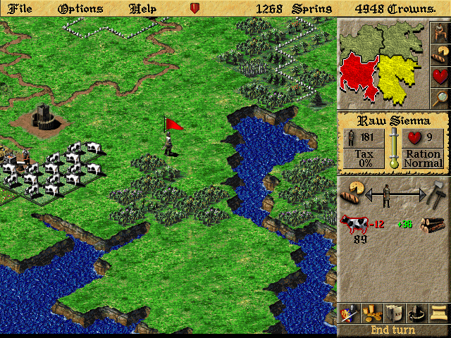
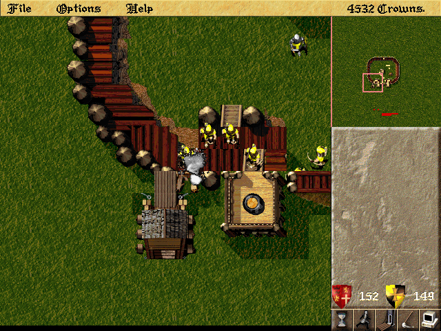
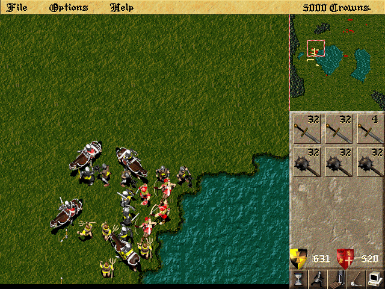
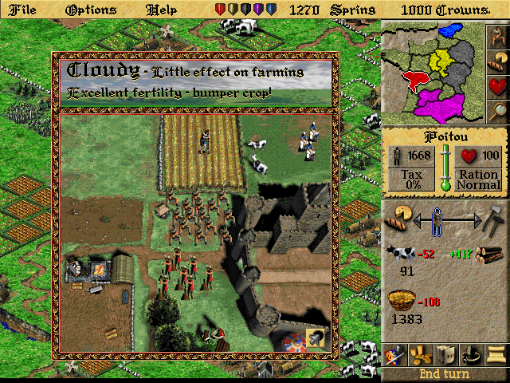

# OpenLords2

An open-source reimplementation of **Lords of the Realm II** (Impressions Games / Sierra On-Line, 1996),
written in C and checked against the original game function by function.

The goal is **full behavioural parity** with the user's own `Lords2.exe` (GOG 2.0.0.3). That means the same game state,
the same random numbers and the same picture on every frame, for the same input. It is not meant to be a byte-identical
recompile, and it is not a "close enough" remake. Parity is proven by running the original and the port on identical
state and comparing them, not by eye.

<p align="center">
  
  
  
  
</p>
<p align="center"><sub>Frames presented by the port running alone (<code>rhost --standalone</code>, no original code),
identical to the original's frames for the same input. Game art © its owners, shown from the author's own copy.</sub></p>

**You need your own copy of the game** (GOG, retail CD …). The repository ships none of its assets: no art, sound,
music, movies, maps or text files, and no decompiler output. The port's C code is written function by function from
study of the original's disassembly (largely by AI agents, each function checked against the original), not
generated by a decompiler. To run without loading anything from `Lords2.exe`, it also carries
the executable's own data tables and built-in strings as C definitions (documented byte by byte in
[`docs/data-ledger.md`](docs/data-ledger.md)).

## Status

**[`docs/STATUS.md`](docs/STATUS.md) is the single source of truth on progress.** It is regenerated on every commit from
the active front ([`docs/FRONT.md`](docs/FRONT.md)), the verification evidence and a scan of `src/`.

In short (2026-11-18):

- The port plays the whole game with no original code running. All 121 recorded scenarios produce the original's exact
  frames, RNG and state: single player, battles, sieges, movies and 39 multiplayer sides.
- 1519 functions have been verified against the original on identical state, with 0 divergences.
- `openlords2.exe` runs the port on real DirectDraw / DirectSound, full screen, and is being play-tested.

**Tested is not the same as verified.** The 121 scenarios come from scripted play, an LLM autoplay bot and autonomous
play agents that drove hundreds of turns of campaigns, battles and multiplayer sessions, reaching 82.6 % of the
original's code. Parity is proven only for what those scenarios exercise. Real players find paths that agents don't, so
the port should not be called verified until enough real gameplay has run through it. The project checks every
recorded session of the port against the original, so playing it is the most useful contribution (see the human queue
in [`docs/FRONT.md`](docs/FRONT.md)).

## How it works

Everything rests on **rhost** ([`tools/rhost/`](tools/rhost/README.md)), an in-process host for the original game:

- **The original runs inside our process.** `Lords2.exe` is mapped at its own base address and run against a software
  DirectDraw / DirectSound / window layer, a virtual clock and a virtual message queue fed by an input trace.
- **Runs are reproducible.** A run is deterministic, headless and fast (thousands of frames a second). Windows and wine
  give identical results, bit for bit.
- **One trace, one end state.** A recorded input trace always reproduces the same state hash.

Each function is ported in the same loop:

1. **Read** the original: IDA pseudocode and disassembly (Ghidra is secondary).
2. **Write** the C port with the original's semantics, on the original's data layout.
3. **Shadow** it. On every call the original runs, then the port runs from the same pre-state, and every byte of state is
   compared. Then the **hybrid** pass replaces every ported function at once, and the scenario corpus must still match
   frame for frame.
4. **Commit** with the evidence line (calls, scenarios, divergences).

Three ways of running the port follow from this loop:

| Mode | What runs | What it proves |
|---|---|---|
| **Hybrid** | Port functions replace the original's inside rhost | Each function, in context |
| **Standalone** (`rhost --standalone`) | Only the port runs; the exe's code is never executed, and the data image is built from the port's own definitions | The whole port, no original code |
| **Product** (`openlords2.exe`) | The standalone on the real platform (DirectDraw full screen, DirectSound, real clock and files) | Playable; see the human queue in FRONT.md |

Scenarios (`tests/scenarios/*/trace.jsonl`) come from four sources:

- human play (`rhost.py record`, or the "Lords II capture" desktop shortcut)
- hand-authored scripts (`rhbot.py`)
- an LLM autoplay bot (`tools/bot/`)
- agent-driven exploration of the live game with in-process savestates (`./rd`, [`tools/drive/`](tools/drive/README.md))

The methodology and why it replaced the earlier Frida harness:
[`docs/audits/2026-10-23-methodology-reset.md`](docs/audits/2026-10-23-methodology-reset.md).

## What we learned about the game

[`docs/findings/engine-quirks.md`](docs/findings/engine-quirks.md) documents 242 behaviours of the original engine, each
checked against the original binary. Some examples:

- **Siege damage is remembered.** Damage to a castle carries over to the next siege, but only if the battle's closing
  scroll runs out.
- **Random events don't come from a fresh roll each time.** They are a walk through a fixed 256-slot deck, they only
  ever hit human players, and they start in 1269.
- **The AI economy is subsidised.** Every turn a computer lord gets free cash (up to 1800), and small AI realms also
  get free people and provisions. On the two hardest settings the AI pays a tenth of a unit's value in wages, where
  you pay a quarter.
- **Marching through foreign land wrecks it.** Terrain the map calls impassable doesn't stop an army: it flattens the
  tile, drains part of that county's stockpile, and pays double movement.

**Watch some of them:** [OpenLords2 Field Notes](https://claude.ai/artifact/EeuM6mtd6c4cTDY8FeuArD) has four short
films rendered from deterministic replays: the original and the port side by side frame for frame, a castle that
remembers its siege damage, knights that give up in front of intact walls, and the event deck.

Per-subsystem write-ups are indexed in [`docs/findings/INDEX.md`](docs/findings/INDEX.md).

## Getting started

You need the GOG release of the game (the setup checks `Lords2.exe`'s sha256) and Nix. Windows 11 or wine runs the
32-bit binaries.

```sh
nix develop                     # or prefix commands with tools/dev (a cached dev env, lighter on memory)
./tools/setup.sh                # symlinks your game into vendor/, prepares analysis dirs
tools/dev make -C src -j16      # the port's modules (mingw32)
tools/dev make -C tests run -j16                        # host unit tests (gcc + ASan/UBSan)
python3 tools/rhost/rhost.py setup                      # build rhost, stage a pristine game copy
python3 tools/rhost/rhost.py corpus --check --target wine               # every scenario vs its blessed hashes
python3 tools/rhost/rhost.py corpus --check --standalone --target wine  # … and again with no original code
python3 tools/rhost/rhost.py verify --target wine                       # shadow every ported function + hybrid pass
python3 tools/rhost/rhost.py product --install                          # openlords2.exe (Windows)
```

To record a gameplay video of a scenario with sound and captions, write a spec in the format given in
[`tools/rhost/film.py`](tools/rhost/film.py)'s docstring, then run:

```sh
tools/dev python3 tools/rhost/film.py spec.json
```

## Layout

```
src/          the port (C, gnu11, mingw32): rl_*.c = retail-layout ports, rl_link*.c = the link layer
tools/rhost/  the in-process host: fake platform layers, hook tables (rh_hooks*.c), rhost.py driver
tools/drive/  agent-driven play (rd): live sessions, savestates, exploration search
tools/bot/    LLM autoplay through rhost
tools/ida/    IDA 9.4 export pipeline (output gitignored)
tests/        host unit tests, scenarios/ (input traces + blessed hashes), probes/ (synthetic carriers)
docs/         STATUS (derived), FRONT, PROGRESS, findings/, data ledger, audits
vendor/       your game files (gitignored)
```

The Frida-era tools (`tools/frida/`, `probe_daemon.py`, `film_*.py`, `tools/traces/`) are legacy. They are kept for
reference and no longer extended.

## License

MIT, see [`LICENSE`](LICENSE). The license covers OpenLords2's own code only; no rights are granted to the original game.
